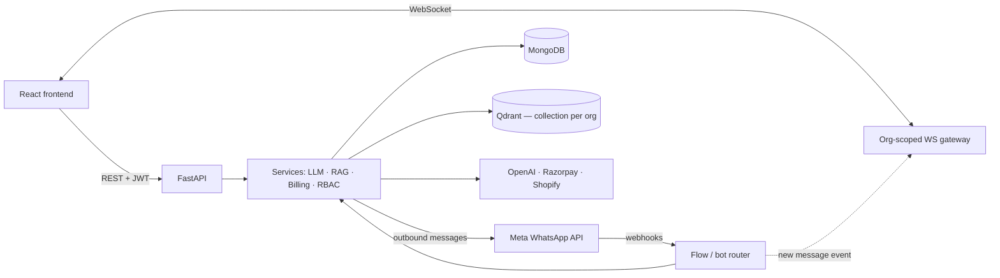

# Zavyo

**Multi-tenant WhatsApp marketing & AI conversation platform — built solo, end to end.**

I was the sole engineer on Zavyo: backend, frontend, AI/RAG layer, billing, and deployment. It lets businesses run WhatsApp campaigns, AI support bots, and no-code conversation flows on the official Meta WhatsApp Cloud API, with every customer organization isolated in a shared multi-tenant system.

> The production source is private. This repo contains the architecture, an engineering write-up, and sanitized excerpts of the most interesting modules, published with the company's permission.
>
> More context and my other projects: [thefrojex.github.io](https://thefrojex.github.io)


---

## At a glance

| | |
|---|---|
| **Role** | Sole engineer — design, build, deploy, maintain |
| **Backend** | FastAPI · Python 3.10 · MongoDB · APScheduler |
| **AI** | OpenAI · RAG over Qdrant (OpenSearch backend option) |
| **Frontend** | React · Vite · ReactFlow · Tailwind |
| **Integrations** | Meta WhatsApp Cloud API · Razorpay · Shopify · Google OAuth |
| **Scale of codebase** | ~330 API endpoints · 30 route modules · 30 services · 79 Mongo collections · ~69k LOC backend |
| **Deployment** | Dockerized, deployed via Coolify |

## What the product does

- **Visual flow builder** — drag-and-drop WhatsApp conversation trees (buttons, branching, webhooks, AI handoff), executed live by a backend flow engine.
- **AI bots** — configurable GPT bots grounded in each company's documents via RAG, with tool-calling (lead routing, HTTP requests, product carousels).
- **Campaigns** — bulk template broadcasts with variable mapping, scheduling, pause/resume, and delivery analytics.
- **Unified inbox** — real-time view of customer, agent, and bot messages over WebSockets.
- **Multi-number routing** — each WhatsApp number runs bot-only, flow-only, or hybrid.
- **Billing & RBAC** — Razorpay plans and credit packs; User → Org Admin → Super Admin permissions.

## Architecture



Full diagram and component notes: [`docs/architecture.md`](docs/architecture.md)

---

## Engineering highlights

### 1. Race-safe, idempotent billing

**Problem:** A single Razorpay payment can be confirmed twice, once by the payment webhook and once by the client's verify call, and sometimes both arrive at the same moment. Applying credits twice leaks revenue. Applying them zero times after a real charge is a support problem.

**Solution:** Benefit application goes through an atomic claim lock, a single conditional `update_one` that acts as a compare-and-set:

```python
# simplified — see modules/billing_idempotency/payment_lock.py
result = payments.update_one(
    {
        "_id": payment_id,
        "benefits_applied": {"$ne": True},
        "$or": [
            {"benefits_applying": {"$ne": True}},
            {"benefits_applying_at": {"$lt": now - timedelta(minutes=10)}},  # stale claim
        ],
    },
    {"$set": {"benefits_applying": True, "benefits_applying_at": now}},
)
if result.modified_count != 1:
    return {"idempotent": True}  # another caller already owns / finished this payment
```

- Two concurrent callers can't both win, because success is judged by `modified_count`, not by a separate read.
- The 10-minute stale window means a crash in the middle of applying benefits doesn't lock that payment forever.
- The same pattern protects **four independent payment paths**: plan purchase, subscription, credit top-up, and reconciliation. Webhook signatures are verified before any of this runs.

### 2. Multi-tenant isolation at every layer

**Problem:** All tenants share one MongoDB. Every path (REST, WebSocket, inbound webhooks, the AI layer) has to scope by organization independently. One missed filter means one customer can see another customer's data.

**Solution:** Isolation is enforced at each boundary, not in a single place:

- **REST:** every tenant route depends on one `get_current_org_context` resolver. It resolves the org from the JWT, re-checks that the org exists and is active, and evaluates RBAC and subscription state.
- **WebSocket:** two independent checks run before a socket joins an org's broadcast group. The JWT's `org_id` claim must match the URL, **and** a fresh DB lookup of the user's org must match. Either mismatch closes the connection with code 1008.
- **Inbound WhatsApp messages:** the tenant is resolved from the receiving phone number's config, never from message content. If the config is missing, the message is rejected with no fallback. If more than one org claims the same number, the webhook is refused instead of guessing.
- **RAG:** each org gets its **own Qdrant collection** rather than a shared collection with a metadata filter. That is a stronger guarantee, traded for more collections to manage.

### 3. A stateful conversation router and flow interpreter

**Problem:** Every inbound message has to go to the right place: an active AI session, a position in a flow graph, a sales rep, or a human agent. This has to keep working when an admin reassigns the bot or edits the flow in the middle of a live conversation.

**Solution:**

- Flows drawn in the ReactFlow editor are **compiled** into a `block_map` and a `route_map` (trigger → next block, with branching) and cached per org. A button reply is resolved back to its position in the graph and dispatched to either a static block handler or an AI-agent handler.
- The router detects when a session's bot was **changed or removed** since the session started. In that case it ends the stale session cleanly instead of replying through a bot that no longer exists.
- AI dispatch runs intent classification concurrently with history loading, and every AI service is constructed with an `org_id`, so tenant scoping carries through the LLM layer too.

### Also built

- **RAG pipeline:** PDF/DOCX/TXT/CSV ingestion, chunking with boundary snapping (1000 chars, 200 overlap), and a vector store abstraction with Qdrant and OpenSearch backends. Embedding calls are **metered against the org's credits**, so AI usage is tied into billing.
- **Webhook deduplication:** Meta redelivers webhooks, so incoming message IDs are checked before insert. This came out of several iterations fixing phone-number attribution bugs.
- **Crash-safe campaigns:** the campaign status is re-checked before every contact, so pause and stop take effect mid-run. Resumed runs skip contacts that were already processed, and final stats are reconciled so a resume never lowers the recorded numbers.
- **Real-time inbox:** org-keyed connection manager that removes dead sockets itself when a broadcast to them fails.

---

## Known limitations & what I'd change next

This was built for a single-instance deployment. These are the tradeoffs I'm aware of, and what I'd do about each:

| Area | Current state | Next step |
|---|---|---|
| Campaign sending | Resumable, but **no rate limiting or 429 backoff** | Per-number token bucket and a proper task queue |
| WebSocket fan-out | In-memory, single process | Redis pub/sub for multi-instance |
| Webhook dedup | App-level check; small race window under simultaneous redelivery | Unique compound index on `(org_id, message_id, direction)` |
| Handover to humans | Rules compile into LLM system-prompt instructions | Deterministic pre-checks (keywords, failure counts) before the LLM |
| Tenant scoping | Enforced by convention at each layer | Repository layer that makes unscoped queries impossible to write |
| `router.py` | 3,000+ line module, sync PyMongo in async path | Split into flow engine / AI dispatch / persistence; move to Motor |
| CI / tests | Manual smoke scripts, no pipeline | pytest suite + GitHub Actions build and deploy |

---

## What's in this repo

```
modules/
  billing_idempotency/     payment_lock.py          atomic claim lock for payment benefits
  multi_tenant_isolation/  org_context.py           per-request org + RBAC + billing resolver
                           websocket_auth.py        double-checked WebSocket admission
  realtime_websocket/      connection_manager.py    org-scoped broadcast manager
  rag_pipeline/            vector_store_service.py  pluggable vector backend + credit metering
docs/
  architecture.md          full architecture diagram and component notes
```

These are excerpts meant to show the approach. They are not a runnable copy of the product.

## Contact

**Abhinav Sharma** · [Portfolio](https://thefrojex.github.io) · [GitHub](https://github.com/thefrojex) · [LinkedIn](https://linkedin.com/in/thefrojex)
