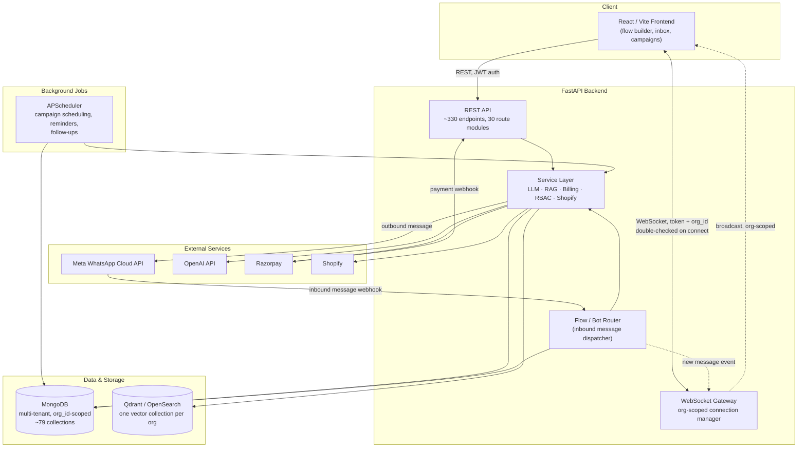

# Architecture

High-level view of the production system this showcase is drawn from — a
multi-tenant WhatsApp marketing and AI-conversation automation platform.

## Component notes

- **REST API** — every tenant-scoped route depends on a single
  `get_current_org_context` resolver (see
  `modules/multi_tenant_isolation/org_context.py`) that resolves org, RBAC
  permissions, and subscription/billing state once per request.
- **WebSocket Gateway** — real-time inbox updates. Connections are
  authenticated with two independent checks (JWT claim + fresh DB lookup)
  before being admitted to an org's broadcast group (see
  `modules/multi_tenant_isolation/websocket_auth.py` and
  `modules/realtime_websocket/connection_manager.py`).
- **Flow / Bot Router** — the entry point for every inbound WhatsApp message.
  Resolves which org/phone number owns the message, which flow or AI bot
  (if any) is currently assigned, and whether an existing AI session should
  continue or be torn down (e.g. because an admin reassigned the bot
  mid-conversation).
- **Service layer** — RAG retrieval (per-org vector collections, credit-
  metered embeddings — see `modules/rag_pipeline/vector_store_service.py`),
  LLM orchestration, RBAC evaluation, and billing (idempotent, race-safe
  benefit application — see `modules/billing_idempotency/payment_lock.py`).
- **Background jobs** — campaign sends, demo-booking reminders, and
  follow-up scheduling run through APScheduler (AsyncIOScheduler, so
  scheduled work doesn't block the FastAPI event loop).

## What this diagram doesn't claim

This is the architecture as built for a single-operator, single-instance
deployment. It is **not** a horizontally-scaled, multi-region system — the
WebSocket layer in particular is in-memory/single-process (no cross-instance
pub/sub), and campaign sending runs as a background thread rather than a
distributed task queue. See `showcase_findings.md` in the source analysis
for the honest tradeoffs behind each component.
